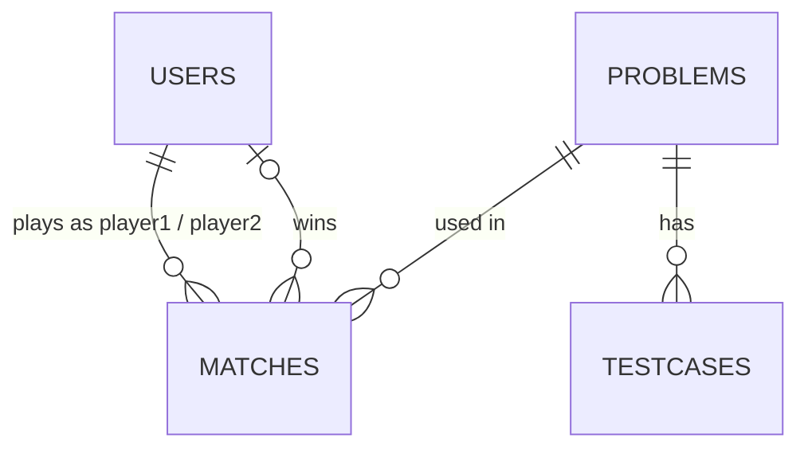

# CodeRace Backend - Database & REST API (Member 2)

Owner: Hafiza Alizada

MySQL database and FastAPI REST API for **CodeRace: Real-Time Coding Duels**.
It stores players, coding problems, test cases and match results, handles
registration and login, and updates Elo ratings when a duel ends.

## Tech stack

| Part            | Technology                                  |
|-----------------|---------------------------------------------|
| Database        | MySQL 8+ (tested on MySQL 26.10)            |
| API framework   | FastAPI (Python 3.11+, tested on 3.14)      |
| Database access | SQLAlchemy 2 + PyMySQL (parameterised SQL)  |
| Passwords       | salted scrypt hashes (Python standard library) |
| Login tokens    | JWT (HS256), valid for 24 hours             |
| Tests           | pytest                                      |

## Folder structure

```
backend/
  app/
    main.py            FastAPI app, health check, router registration
    config.py          settings read from .env
    database.py        MySQL connection
    dependencies.py    current-user and internal-key checks
    security.py        password hashing and JWT tokens
    elo.py             Elo rating formula
    schemas.py         request/response data shapes
    routers/
      auth.py          register, login, current user
      users.py         public profiles, account update, match history
      leaderboard.py   global ranking
      problems.py      problem details (public / internal)
      matches.py       create and finish matches (internal)
  database/
    schema.sql         creates the database and its 4 tables
    problems.json      coding problems and their test cases
  scripts/
    seed_problems.py   checks problems.json and loads it into MySQL
  tests/               automated tests (pytest)
  .env.example         template for the private .env file
  requirements.txt     packages needed to run the API
  requirements-dev.txt packages needed to run the tests
```

## Setup (Windows PowerShell)

1. Create the database (from the repository root, `Capstone_project`):

       cmd /c "mysql -u root -p < backend\database\schema.sql"

   Warning: re-running `schema.sql` deletes all data in the 4 tables.

2. Create the app database user (once), logged in as root with `mysql -u root -p`:

       CREATE USER IF NOT EXISTS 'coderace_app'@'localhost' IDENTIFIED BY 'choose-a-password';
       GRANT SELECT, INSERT, UPDATE, DELETE ON coderace.* TO 'coderace_app'@'localhost';

3. From the `backend` folder, create the Python environment:

       python -m venv .venv
       .venv\Scripts\Activate.ps1
       python -m pip install -r requirements-dev.txt
       copy .env.example .env

4. Edit `.env` (never commit it). Generate each secret key with:

       python -c "import secrets; print(secrets.token_urlsafe(48))"

5. Load the coding problems:

       python -m scripts.seed_problems

6. Start the server:

       uvicorn app.main:app --reload

- Health check: http://127.0.0.1:8000/api/health
- Interactive API docs: http://127.0.0.1:8000/docs

## Configuration (.env)

| Variable             | Meaning                                              |
|----------------------|------------------------------------------------------|
| `DB_HOST`, `DB_PORT` | MySQL server (default `localhost`, `3306`)           |
| `DB_USER`            | app database user (`coderace_app`)                   |
| `DB_PASSWORD`        | password of the app database user                    |
| `DB_NAME`            | database name (`coderace`)                           |
| `JWT_SECRET_KEY`     | long random secret that signs login tokens           |
| `JWT_ALGORITHM`      | `HS256`                                              |
| `JWT_EXPIRE_MINUTES` | token lifetime (default 1440 = 24 hours)             |
| `INTERNAL_API_KEY`   | secret shared with the real-time engine and sandbox  |

## Database design



| Table       | Purpose | Notable rules |
|-------------|---------|---------------|
| `users`     | accounts, Elo rating, statistics | starts at 1000 Elo; `rank_tier` is generated automatically from Elo; username and email are unique; wins + losses + draws must equal matches played |
| `problems`  | coding challenges | difficulty Easy/Medium/Hard; game mode speed_duel/bug_hunt/optimization; 2000 ms and 128 MB limits by default |
| `testcases` | visible and hidden tests | inputs and expected output stored as JSON; deleted automatically with their problem |
| `matches`   | one duel between two players | players must differ; the winner must be one of the players; Elo before and change saved for both players |

Rank tiers: **Bronze** 0-1199, **Silver** 1200-1499, **Gold** 1500-1799, **Diamond** 1800+.

## API endpoints

Auth column: **-** = public, **Token** = logged-in user (`Authorization: Bearer <token>`),
**Internal** = trusted servers only (`X-Internal-Key: <INTERNAL_API_KEY>`).

| Method | Path | Auth | Description |
|--------|------|------|-------------|
| GET   | `/api/health` | - | API and database status |
| POST  | `/api/auth/register` | - | create an account |
| POST  | `/api/auth/login` | - | log in (form fields `username` + `password`), returns a token |
| GET   | `/api/auth/me` | Token | the logged-in user's account |
| PATCH | `/api/users/me` | Token | change email and/or password (needs current password) |
| GET   | `/api/users/{username}` | - | public profile and statistics |
| GET   | `/api/users/{username}/matches` | - | match history, newest first (`limit`, `offset`) |
| GET   | `/api/leaderboard` | - | players ranked by Elo (`limit`, `offset`) |
| GET   | `/api/problems/{id}` | - | problem with visible tests only |
| GET   | `/api/problems/{id}/all-tests` | Internal | problem with visible and hidden tests |
| POST  | `/api/matches` | Internal | start a match and choose a problem |
| POST  | `/api/matches/{id}/finish` | Internal | save the result and update Elo |
| GET   | `/api/matches/{id}` | - | details of one match |

## Guide for teammates

**Member 1 (frontend)**
- Register: `POST /api/auth/register` with JSON `{"username", "email", "password"}`.
- Login: `POST /api/auth/login` as form data (`application/x-www-form-urlencoded`)
  with `username` (or email) and `password`. Save `access_token` and send it as
  `Authorization: Bearer <token>` on protected requests.
- Profile, leaderboard and history pages use the public `GET` endpoints above.

**Member 3 (problems and tests)**
- Add problems to `database/problems.json` (copy an existing problem as a template).
- Each problem needs 5-10 tests with at least one visible and one hidden test.
  `input` is the list of function arguments, `expected` is the return value.
- Add a `reference_solution` so every expected answer is checked automatically.
- Check the file without touching the database: `python -m scripts.seed_problems --check`

**Member 4 (sandbox)**
- Get the problem with all tests: `GET /api/problems/{id}/all-tests` with the
  `X-Internal-Key` header. Call `function_name(*input)` and compare the result
  with `expected`.

**Member 5 (real-time engine)**
- When two players are paired: `POST /api/matches` (internal) with
  `{"player1_username", "player2_username", "game_mode"}`. Optional:
  `difficulty` or `problem_id`. Without them, the difficulty is chosen from the
  players' average Elo. The response contains the match `id` and `problem_id`.
- When the match ends: `POST /api/matches/{id}/finish` (internal) with
  `{"winner_username": "..."}` for a win, `{"winner_username": null}` for a draw,
  or `{"winner_username": "...", "abandoned": true}` if the other player left.
  `{"abandoned": true}` with no winner ends the match without rating changes.

## Elo rating rules

- K-factor 32. Expected score: `1 / (1 + 10^((opponent - rating) / 400))`.
- Change = `round(32 x (result - expected))`, where result is 1 (win), 0.5 (draw) or 0 (loss).
- The two players' changes always add up to zero.
- Examples: equal players, win = +16 / -16; 1000 beats 1400 = +29 / -29; 1400 beats 1000 = +3 / -3.

## Running the tests

    python -m pytest -v

The 12 tests check the Elo formula and the problems.json checker. They do not
need MySQL or the server.

## Troubleshooting

- **"Access denied for user 'coderace_app'"**: the password in `.env` does not match MySQL. Restart the server after editing `.env`.
- **"running scripts is disabled"** when activating `.venv`: run `Set-ExecutionPolicy -Scope CurrentUser -ExecutionPolicy RemoteSigned` once.
- **`uvicorn` is not recognized**: the terminal has no `(.venv)`. Run `.venv\Scripts\Activate.ps1` first.
- **"An Application Control policy has blocked this file"** (Windows Smart App Control): reinstall SQLAlchemy without compiled files:

      $env:DISABLE_SQLALCHEMY_CEXT = "1"
      python -m pip install --force-reinstall --no-deps --no-binary sqlalchemy sqlalchemy==2.1.9

- **403 "Missing or invalid internal API key"**: send the `X-Internal-Key` header with the value of `INTERNAL_API_KEY` from `.env`.